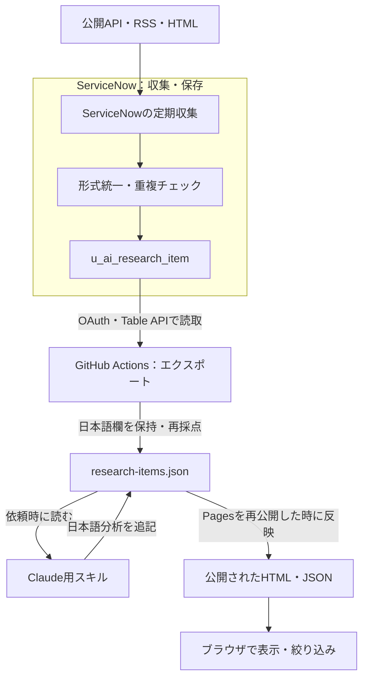

# ServiceNow Research Viewer：システム内部の連関図

[servicenow-system-map.canvas](servicenow-system-map.canvas) をObsidianのVault内へ置いて開いてください。6カテゴリ・19項目、アプリの特徴3項目と4本の処理経路を収録しています。短い説明から右側の内部仕様へ進み、下側の「つながり」で実際のデータの流れを追えます。[元データ](servicenow-system-map.data.json)は個人スキル `obsidian-app-mindmap` の `build_canvas.py` で再生成できます。

## このアプリがしていること

公開ニュース・論文・困りごと・ハッカソン情報をServiceNowへ収集し、GitHubのJSONへ取り出してWeb画面で読む仕組みです。必要な記事は、依頼時にClaude用スキルで日本語分析を付けます。

**集める係＝ServiceNow、取り出す係＝GitHub Actions、理解する係＝Claude用スキル、見せる係＝ブラウザ**という分担です。収集ジョブ自体がLLMを呼び出す構成ではありません。

## 全体のつながり

矢印はデータ・結果の流れを表します。下図の「公開時」は重要な条件です。

## 内部の役割

| 部分 | やさしい説明 | 主な実装 |
|---|---|---|
| 情報源 | 元のニュース等がある場所。9観点をコードで分類 | Scheduled Job、REST Message設定 |
| ServiceNow | 外部通信、定期実行、データ保存を担当する裏側 | `sn_ws.RESTMessageV2`、`GlideRecord`、`u_ai_research_item` |
| エクスポート | 保存済みの記事を500件ずつ取り出す | `export_research_items.mjs`、共通OAuthクライアント |
| JSON | WebとClaudeが共通で使う記事データ | `data/research-items.json` |
| 日本語分析 | 原文を読んで、概要・要点・使い道を加える | `research-item-curation`、`hackathon-winner-curation` |
| おすすめ順 | 関心のあるキーワードに点数を付ける | `score_items.mjs`。学習型の推薦AIではない |
| Web画面 | JSONを読み、条件に合わせて記事を並べる | `index.html`。HTML・CSS・JavaScript、閲覧用 |
| 設定用Actions | 外部通信の設定と既存ジョブ本文を管理する | `servicenow-setup.yml`。手動実行、dry-run初期値true |
| 別件のBusiness Rule | カタログ更新時のログ出力。リサーチ本体とは独立 | `servicenow-business-rules.yml`、`setup_business_rule_sc_cat_item.mjs` |

## 1件の記事が表示されるまで

1. ServiceNowの定期ジョブが、設定済みのREST Messageで情報源へGETする。
2. JSON・RSS・Atom・HTMLを共通の項目へ揃え、日付をUTC形式へ直す。
3. URL由来のキーで既存行を確認し、新しい記事をテーブルへ登録する。ハッカソンは状態変化も別行で残す。
4. ActionsがOAuthで認証し、Table APIから全件を取り出す。既存の日本語欄はsysIdで引き継ぐ。
5. キーワードの点数を再計算し、JSONを保存する。変更がある場合のみcommit・pushする。
6. 必要な記事についてClaude用スキルを実行し、日本語分析とcuratedフラグを付ける。この処理は依頼時の作業で、収集ジョブによる自動要約ではない。
7. GitHub Pagesを再公開すると、その時点のHTML・JSONが配信される。ブラウザは公開先のJSONを全件取得して表示する。

## 現行構成の確認事項

### 収集は9カテゴリ、画面用の辞書は7まで

収集コードには1〜9が定義されていますが、エクスポートの `CATEGORY_LABELS` は1〜7です。Web画面のカテゴリボタンはこの辞書から作るため、8・9の専用ボタンや名前表示が欠ける構造です。実データに8・9の記事が存在するかは、今回のサイズ制限で未確認です。

### JSON更新とWeb公開は別の処理

exportは標準の `GITHUB_TOKEN` でpushする構成で、Pagesワークフローはmainへのpushまたは手動操作が入口です。[GitHub公式仕様](https://docs.github.com/ja/actions/concepts/security/github_token)では、`GITHUB_TOKEN` によるpushから次のpushワークフローは通常起動しません。exportからPagesへ直接つなぐ処理は見当たりません。

確認した直近8実行には、10月12〜17日のexport成功があり、Pagesの最新成功は10月11日でした。このことから、定期JSON更新だけで閲覧サイトも毎日最新になるとは言えません。今回、稼働中のWeb画面の内容までは照合していません。

### 手動部分と自動部分

- テーブル・フィールド・カテゴリChoice・ジョブの新規作成と頻度設定は、手動作業が残ります。
- 設定同期Actionsは手動起動です。ジョブ本文は更新できますが、GitHubへpushしただけでServiceNowへ同期される設定ではありません。
- 日付グループは `createdAt` が優先されます。「記事の元公開日」でまとまるとは限りません。
- 日本語欄は引き継ぎますが、出力は今回ServiceNowから取得した行が基準です。削除済み行を永続的に残す追記アーカイブではありません。
- 意味検索はREADMEでは将来の構想です。現在確認できる推薦はキーワード加点で、Web画面に意味検索欄はありません。

## 確認範囲と根拠

- 確認日：2026-10-17 JST
- 対象コミット：[42d9f2803f99a0927e2f9bb9f9edf87824fdc2b8](https://github.com/gurii-gabreh/servicenow-sub-agent/tree/42d9f2803f99a0927e2f9bb9f9edf87824fdc2b8)
- [収集処理](https://github.com/gurii-gabreh/servicenow-sub-agent/blob/42d9f2803f99a0927e2f9bb9f9edf87824fdc2b8/servicenow/scheduled_job_ai_research_fetch.js)
- [エクスポートとマージ](https://github.com/gurii-gabreh/servicenow-sub-agent/blob/42d9f2803f99a0927e2f9bb9f9edf87824fdc2b8/servicenow/scripts/export_research_items.mjs)
- [閲覧画面](https://github.com/gurii-gabreh/servicenow-sub-agent/blob/42d9f2803f99a0927e2f9bb9f9edf87824fdc2b8/index.html)
- [2026-10-17のexport成功](https://github.com/gurii-gabreh/servicenow-sub-agent/actions/runs/39004072696)：13:50 JST開始。定義上のcronは09:30 JSTですが、実行は遅延しています。
- [今回確認した最新Pages成功：2026-10-11](https://github.com/gurii-gabreh/servicenow-sub-agent/actions/runs/38137351365)

コード・運用文書・Actions履歴を確認した構成説明です。稼働中のServiceNowへのログイン検証、情報源の現在の全応答確認は行っていません。research-items.jsonは約4.2MBで、接続ツールから本文を取得できず、実記事数や実内容の評価は対象外です。Obsidian実アプリでの表示確認は未実施です。

図と説明資料を作成したもので、ServiceNow設定やリサーチアプリ本体のコードは変更していません。
